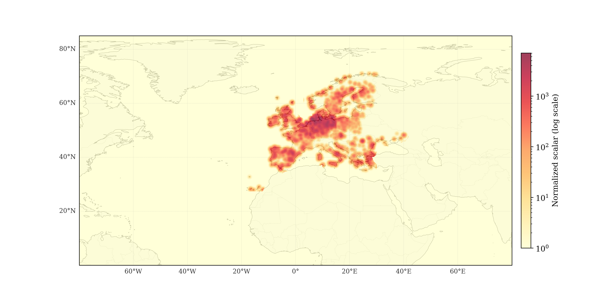

# Miner Guide

## Table of Contents

1. [Installation 🔧](#installation)
2. [Registration ✍️](#registration)
3. [Setup ⚙️](#setup)
4. [Mining ⛏️](#mining)
5. [What to return in each phase](#what-to-return-in-each-phase)

## Before you proceed ⚠️

**Be aware of the minimum compute requirements** for our subnet, detailed in [Minimum compute YAML configuration](../min_compute.yml). A GPU is required for training (unless you want to wait weeks for training to complete), but is not required for inference while running a miner.

## Installation

Download the repository and navigate to the folder.

```bash
git clone https://github.com/Orpheus-AI/Zeus.git && cd Zeus
```

We recommend using a Conda virtual environment to install the necessary Python packages.  

You can set up Conda with this [quick command-line install](https://docs.anaconda.com/free/miniconda/#quick-command-line-install). Note that after you run the last commands in the miniconda setup process, you'll be prompted to start a new shell session to complete the initialization. 

With miniconda installed, you can create a virtual environment with this command:

```bash
conda create -y -n zeus python=3.11
```

To activate your virtual environment, run `conda activate zeus`. To deactivate, `conda deactivate`.

Install the remaining necessary requirements with the following chained command. This may take a few minutes to complete.

```bash
conda activate zeus
chmod +x setup.sh 
./setup.sh
```


## Registration

To mine on our subnet, you must have a registered hotkey.

*Note: For testnet tao, you can make requests in the [Bittensor Discord's "Requests for Testnet Tao" channel](https://discord.com/channels/799672011265015819/1190048018184011867)*

To reduce the risk of deregistration due to technical issues or a poor performing model, we recommend the following:

1. Test your miner on testnet before you start mining on mainnet.
2. Before registering your hotkey on mainnet, make sure your port is open by running `curl your_ip:your_port`
3. If you've trained a custom model, test it's performance by deploying to testnet.


#### Mainnet

```bash
btcli s register --netuid 18 --wallet.name [wallet_name] --wallet.hotkey [wallet.hotkey] --subtensor.network finney
```


#### Testnet

```bash
btcli s register --netuid 301 --wallet.name [wallet_name] --wallet.hotkey [wallet.hotkey] --subtensor.network test
```


## Setup

Before launching your miner, make sure you have a file called `miner.env`. `setup.sh` creates an empty template if it does not exist yet. This file will not be tracked by git. 
You can use the sample below as a starting point, but make sure to replace **wallet_name**, **wallet_hotkey**, and **axon_port**.

```bash
# Subtensor Network Configuration:
NETUID=18                                      # Network User ID options: 18,301
SUBTENSOR_NETWORK=finney                       # Networks: finney, test, local
SUBTENSOR_CHAIN_ENDPOINT=wss://entrypoint-finney.opentensor.ai:443
                                               # Endpoints:
                                               # - wss://entrypoint-finney.opentensor.ai:443
                                               # - wss://test.finney.opentensor.ai:443/

# Wallet Configuration:
WALLET_NAME=default
WALLET_HOTKEY=default

# Miner Settings:
AXON_PORT=
BLACKLIST_FORCE_VALIDATOR_PERMIT=True          # Default setting to force validator permit for blacklisting
```


## Mining

Now you're ready to run your miner!

```bash
conda activate zeus
./start_miner.sh
```

### Whitepaper
Although the subnet is continuously updating the basic idea's are explained in our whitepaper.
We highly recommend that you read this before starting to mine on our subnet.

You can read the paper on our website:
[whitepaper link](https://www.zeussubnet.com/news-and-updates/ZEUS_V2_Benchmark.pdf)


### Input and desired output data

The datasource for this subnet consists of ERA5 reanalysis data from the Climate Data Store (CDS) of the European Union's Earth observation programme (Copernicus). This comprises the largest global environmental dataset to date, containing hourly measurements across a multitude of variables. 

**Request Schedule:**
There are 4 forecast rounds per day, starting at 00:00, 06:00, 12:00, and 18:00 UTC. Each round has an on-chain commit window from minute `:30` to minute `:45` of that hour (e.g. 00:30–00:45 UTC). In each round the validator issues **multiple challenges**: one per combination of **ERA5 variable** and **forecast horizon** (see [constants](../zeus/validator/constants.py)). Geography and step size are the same for all challenges:

- **Geographical coverage**: Always the entire Earth (full latitude and longitude range)
- **Step size**: Always 1 hour between prediction time steps
- **Forecast horizons** (identified by `requested_hours`, the length of the time dimension):
  - **Short-term:** 49 hourly steps from the round start (t=0, i.e. 00, 06, 12 or 18 UTC) through **+48 hours** (`requested_hours == 49`).
  - **Long-term:** 361 hourly steps from the round start through **+360 hours** (15 days, `requested_hours == 361`).

Each challenge focuses on a single variable. Supported variables and variable weights are defined in [constants](../zeus/validator/constants.py):


| Variable                            | Weight |
| ----------------------------------- | ------ |
| `2m_temperature`                    | 0.2    |
| `100m_u_component_of_wind`          | 0.3    |
| `100m_v_component_of_wind`          | 0.3    |
| `surface_solar_radiation_downwards` | 0.2    |


These variable weights are combined with the time-window weights used by validators: short-term challenges currently contribute 0.2 and long-term challenges contribute 0.8.

#### **Input Format:**

The validator sends you a request containing:

- **Bounding box coordinates**: `latitude_start`, `latitude_end`, `longitude_start`, `longitude_end` (always -90 to 90 for latitude, -180 to 179.75 for longitude)
- **Time range**: `start_time` and `end_time` (float timestamps in UTC, aligned to the horizon)
- **Number of time steps**: `requested_hours` — **49** for short-term or **361** for long-term
- **Step size**: `step_size` (always 1 hour)
- **Variable**: `variable` (string identifying the ERA5 variable to predict)

The geographical grid is generated from the bounding box with a resolution of 0.25 degrees, resulting in a fixed grid size of 721 × 1440 points (latitude × longitude) for the entire Earth.

### **Scoring**

You will be scored based on both the Root Mean Squared Error (RMSE) and Mean Absolute Error (MAE) between your predictions and the actual ground truth at those locations for the requested timepoints. The final score is the average of these two metrics: `(RMSE + MAE) / 2`. Ground truth is not available at request time; scoring runs once ERA5 covers **every** timestep in that challenge's window. Short horizons therefore tend to be scored sooner than the 15-day long horizon.

Your goal is to minimize both RMSE and MAE, which will improve your ranking and subnet incentive. Scoring works as follows:

- **Competition ranking**: Miners are ranked on `(RMSE + MAE) / 2` (lower is better). Ties on RMSE can share the same competition rank.
- **Latitude / area weighting**: Grid cells near the equator cover more area than polar cells, so RMSE and MAE use latitude-based area weights (see [ScoringChallengesCalculatingWeights.ipynb](../notebooks/ScoringChallengesCalculatingWeights.ipynb)).
- **Geographic scalars (per variable)**: Each cell is also multiplied by a variable-specific geographic scalar field loaded from [zeus/data/weights](../zeus/data/weights) (see `WIND_SCALARS_PATH`, `SOLAR_SCALARS_PATH`, `TEMPERATURE_SCALARS_PATH` in [constants.py](../zeus/validator/constants.py)). Each field gives Germany and the rest of Europe a large share of the weight, distributed in proportion to energy-relevant density, and gives the rest of the world a uniform baseline:


| Variable                                                   | Scalar file                 | Weighted by                                 | Notebook                                                             |
| ---------------------------------------------------------- | --------------------------- | ------------------------------------------- | -------------------------------------------------------------------- |
| `100m_u_component_of_wind`, `100m_v_component_of_wind`     | `new_wind_scalars.npz`      | Operating wind-farm capacity                | [NewScalarMap-Wind.ipynb](../notebooks/NewScalarMap-Wind.ipynb)      |
| `surface_solar_radiation_downwards`                        | `new_solar_scalars.npz`     | Operating utility-scale solar capacity      | [NewScalarMap-Solar.ipynb](../notebooks/NewScalarMap-Solar.ipynb)    |
| `2m_temperature`                                           | `new_temperature_scalars.npz` | Population density                          | [NewScalarMap-Temp.ipynb](../notebooks/NewScalarMap-Temp.ipynb)      |


The product of the area weight and the geographic scalar is **mean-normalized** before RMSE/MAE. Full formulas are in [ScoringChallengesCalculatingWeights.ipynb](../notebooks/ScoringChallengesCalculatingWeights.ipynb). The map below shows the wind scalars; the solar and temperature maps are in [notebooks](../notebooks):



> NOTE: these scalars apply to challenges starting at or after 25 August 2026 18:00 UTC. Older challenges used the axis-aligned Europe (1.5) / Germany (2.5) box weights from [region_mask.py](../zeus/utils/region_mask.py), visualized in [OldScalarMap.ipynb](../notebooks/OldScalarMap.ipynb).

- **Subnet weights from win rate**: Incentive weights are computed **per variable × horizon** from the miner's rank history. When loading history, validators only keep ranks whose `challenge_enddate` is at or before the **last completed 6-hour window** (`floor(now UTC, 6h) − 6h`), so the current cycle is excluded. They then take the last `window_size` of those ranks (defaults: **4** for short-term, **8** for long-term) and score the miner by its **win rate**: the fraction of those challenges where it was ranked **1st**. Ties in win rate are broken in favour of the most recent wins. Miners with fewer than `window_size` ranks are ordered last. (Before 16 October 2026 12:00 UTC the average rank was used instead.) See [reward.py](../zeus/validator/reward.py) (`compute_avg_ranks`), [results_state.py](../zeus/utils/results_state.py), and the scoring notebook for details.
- **Inactive / repeated penalties**: If a miner has at least **8** consecutive penalties on a challenge (including missed challenges, which are stored as penalties), they get **no weight** on that challenge, unless they registered in the **last 4 weeks**. Shape errors, missing responses, hash mismatches, and collusion all count as penalties.

Miners receive shape penalties for incorrect output shapes, non-finite values, missing responses, or (for challenges starting at or after 2 September 2026 18:00 UTC) any negative value in a `surface_solar_radiation_downwards` prediction. The collusion penalty is applied to every variable except `surface_solar_radiation_downwards`.

> [!IMPORTANT]
> There are 4 rounds per day starting at 00:00, 06:00, 12:00, and 18:00 UTC, with the on-chain commit window at minutes `:30`–`:45`. Each challenge is always for the entire Earth (721 × 1440 grid points) and either **49** or **361** hourly steps. Compress the float16 array with the same layout: `(requested_hours, 721, 1440)`.


### What to return in each phase

The miner no longer receives an axon request for the hash phase. Hashes are committed directly to chain, and validators later request full predictions over axon. The reveal request can happen during the validator's top-miner query phase (long-term challenges only, from the next full hour after the commit window, e.g. 01:00 UTC) or during final scoring. The committed hash and the revealed compressed bytes must match in either case.


| Phase                                  | Interface                              | What you do                                                                                                                                                                                                                                                                                                                                                                            | Do not send                                                                                                                                                          |
| -------------------------------------- | -------------------------------------- | -------------------------------------------------------------------------------------------------------------------------------------------------------------------------------------------------------------------------------------------------------------------------------------------------------------------------------------------------------------------------------------- | -------------------------------------------------------------------------------------------------------------------------------------------------------------------- |
| **Commit (hash)**                      | Subtensor `Commitments.set_commitment` | Pack one `sha256(compressed_bytes + hotkey_ss58.encode("utf-8")).hexdigest()` per challenge into a `ChallengeCommitment` and submit it on-chain. The current layout stores long-window hashes and short-window hashes as deterministic Raw fields. Commit inside the commit window: validators read the chain at minute `:45` (`CHALLENGE_HASHING_MAX_MINUTE`) and reject commitments older than `COMMITMENT_MAX_BLOCKS_OLDER` (75 blocks, about 15 minutes), so the commitment must land between minute `:30` and `:45`. | Do not wait for a validator axon request; the current protocol uses chain commitments for the hash phase.                                                            |
| **Reveal / Scoring (full prediction)** | `TimePredictionSynapse`                | Set `synapse.predictions` to the **base64-encoded** string of the **same** blosc2-compressed prediction (the one you committed on-chain). So: same tensor -> `compress_prediction(tensor)` -> `base64.b64encode(compressed).decode("ascii")`. The validator verifies that `sha256(compressed + hotkey)` equals the hash read from chain. If this verification fails you get a penalty. | Do not change or substitute a different prediction; it must match the on-chain hash or you are marked bad. Honor `requested_hours` and time fields from the synapse. |


**Summary:**

1. **Hash phase:** Compute your prediction tensor, compress it with blosc2, hash the compressed bytes with your hotkey, and commit the packed hashes to the blockchain between minute `:30` and `:45` of the round hour.
2. **Reveal / scoring phase:** Return the **same** compressed prediction as base64 in the `predictions` field of `TimePredictionSynapse`. Use the same compression (and blosc2 version) as in the requirements so the validator can decode and verify.
3. **Caching recommendation:** Store the compressed bytes by challenge, or make your prediction pipeline deterministic enough to reproduce identical compressed bytes. Recomputing a numerically similar tensor is not enough if the compressed bytes differ from the on-chain committed hash.

The [default miner](../neurons/miner.py) implements `on_challenge_block` for on-chain commitments and `_forward_unhashed_predictions` for reveal/scoring.
The [protocol](../zeus/protocol.py) defines `TimePredictionSynapse`; on-chain commitment packing is handled by [zeus.commitment](../zeus/commitment.py).
